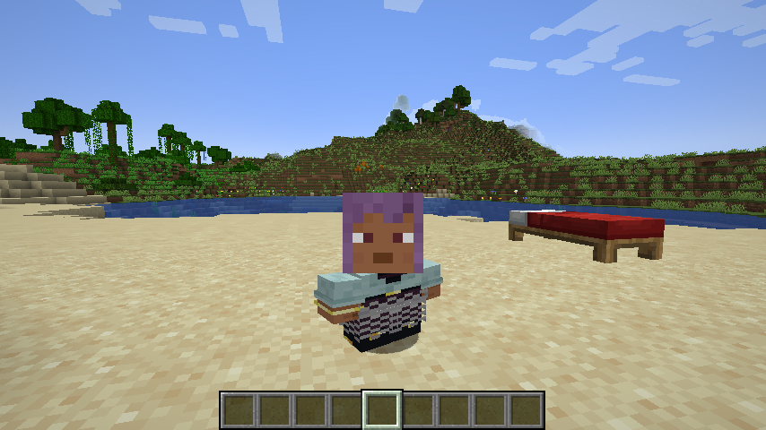
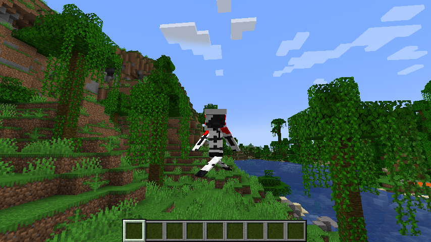

# Pehkui Proportions Addon

Pehkui Proportions Addon adds the capability to Pehkui to control individual parts of human mob models, such as zombies and players.

This allows for some silly scaling like this!

This mod avoids the player from seeming artificially squished or shrunk and allows for much natural looking variations of size.
It also doesn't break as much when the player is tilted, such as swimming.

This mod adds the following scale types to Pehkui
 - `head`
 - `torso_x`
 - `torso_y`
 - `torso_z`
 - `arm_x`
 - `arm_y`
 - `arm_z`
 - `leg_x`
 - `leg_y`
 - `leg_z`
 - `body_height`
 - `body_depth`
 - `arm_width`
 - `leg_width`

This mod does not add any way that uses these capabilities in game. I leave that to other mods to do.

## Commands

This mod adds two additional commands that can be used to do some complex transformations more easily.

`\scale proportions dwarfscale set [target] [value]`

Scales `[target]`'s base scale to `[value]` but keeps `[target]` head size the same, squishing the body to make the difference.

`\scale proportions widescale set [target] [value]`

Increases `[target]`'s hitbox width to `[value]` and increases the body size to make the difference, but keeps `[target]` the same height.

The order of these commands matters because they touch multiple attributes at once.

Example:
`\scale proportions widescale set @p 2`
`\scale proportions dwarfscale set @p 0.5`

Reduces the player's height from 1 to 2 blocks, but keeps the width the same and does not crush the overall model.

## **Disclaimer**

This unofficial addon that adds some capabilities to Pehkui has no official affiliation with Virtuoel or Pehkui.
Normally I would do something like fork and open a pull request, but [Pehkui](https://github.com/Virtuoel/Pehkui) hasn't gotten updates in a bit.